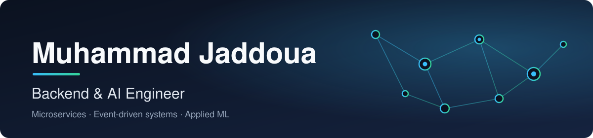

  

  
  
  

  Computer Science at <b>KFUPM</b> · graduating December 2026

## What I'm working on

<table>
  <tr>
    <td align="center" width="110"></td>
    <td><b>AI Developer at DStation.</b> Building full-stack internal platforms and compliance tooling.</td>
  </tr>
  <tr>
    <td align="center"></td>
    <td><b>Senior project.</b> The ML engine and inference backend for a digital twin that diagnoses pump faults in real time.</td>
  </tr>
  <tr>
    <td align="center"></td>
    <td><b>Gradus.</b> A life-management app I'm designing before writing any code.</td>
  </tr>
</table>

## Featured work

<table>
  <tr>
    <td width="33%" valign="top">
      <b><a href="https://github.com/amussab/Digital-Twin-Senior-Proj">🛰️ Edge AI Digital Twin</a></b> 
      Real-time pump fault diagnosis and remaining-life prediction. 12.6% error on synthetic data.  
      PyTorch · XGBoost · ONNX · ASP.NET Core
    </td>
    <td width="33%" valign="top">
      <b><a href="https://github.com/Muhammad-Jaddoua/governance-gap-detector">🧠 Governance Gap Detector</a></b> 
      Offline RAG over a 173-page regulation that flags what it doesn't cover instead of guessing.  
      Python · FastAPI · Qdrant · Ollama
    </td>
    <td width="33%" valign="top">
      <b><a href="https://github.com/Muhammad-Jaddoua/Library-System">🏗️ Library System</a></b> 
      Event-driven microservices with a gateway, JWT auth and Kafka. One command to run.  
      Spring Boot · Kafka · PostgreSQL · Docker
    </td>
  </tr>
</table>

**🎮 Games in Unity:** [ECHO-HEART](https://github.com/Muhammad-Jaddoua/ECHO-HEART) · [Sparkle-Breakout](https://github.com/Muhammad-Jaddoua/Sparkle-Breakout) · [2D-Roguelike](https://github.com/Muhammad-Jaddoua/2D-Roguelike) ([play](https://play.unity.com/en/games/fdcce95e-fbdd-44e7-94e6-e2fb74bfa8d3/web)) · [Sprite-Flight](https://github.com/Muhammad-Jaddoua/Sprite-Flight)

## Tech stack

<table>
  <tr>
    <td><b>Backend</b></td>
    <td></td>
  </tr>
  <tr>
    <td><b>AI / ML</b></td>
    <td>
       
      XGBoost · LightGBM · ONNX · pandas · NumPy · RAG · Qdrant · Ollama
    </td>
  </tr>
  <tr>
    <td><b>Frontend</b></td>
    <td></td>
  </tr>
  <tr>
    <td><b>Data &amp; Infra</b></td>
    <td>
       
      SQL · Liquibase
    </td>
  </tr>
  <tr>
    <td><b>Game dev</b></td>
    <td></td>
  </tr>
</table>
